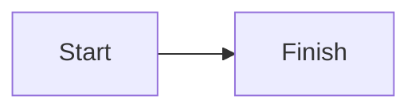

# Markdown documentation reader

An Astro site for browsing a folder of Markdown documents. It renders Mermaid code blocks in the browser, displays linked images and files, and provides a zoom viewer for diagrams. The build can generate SVGs from PlantUML (`.puml`) and BPMN 2.0 (`.bpmn`) sources.

## Set up a document folder

Put this tool in a folder beside your documentation, or set `DOCS_ROOT` to the folder you want to read. The default document root is the parent of this tool directory. A dedicated documentation folder is recommended:

```text
project/
  docs/
    README.md
    getting-started.md
    architecture/
      README.md
      system.md
      system.svg
      system.puml
  reader/                 # this tool; DOCS_ROOT=../docs
```

Any number of nested folders works. At least one `.md` file is required. A root `README.md` supplies the site title and introduction; without one, the folder name is used. Folder README files appear in navigation. Hidden folders, build output, dependencies, and this tool's own directory are excluded.

Use relative links from the Markdown file to other pages and assets:

```markdown
[System design](./architecture/system.md)

```

Use a fenced `mermaid` block for a diagram rendered in the browser:

````markdown

````

For PlantUML or BPMN, put the source beside its generated SVG and link the `.svg` from Markdown. `npm run build` generates SVGs before copying assets. PlantUML requires the `plantuml` command and Java; it is needed only when `.puml` files exist. BPMN sources must include BPMN-DI layout data supported by the generator.

## Run the reader

Node.js 20.19+ is required. Run commands from this tool directory:

```sh
npm ci
DOCS_ROOT=../docs npm run dev
```

Open the URL printed by Astro, usually `http://localhost:4321`. Omit `DOCS_ROOT` when the parent folder itself contains the documents. `DOCS_ROOT` accepts an absolute or tool-directory-relative path. Restart the dev server after adding documents or changing generated diagram sources.

```sh
DOCS_ROOT=../docs npm run build
npm run preview
```

The build validates Mermaid blocks, generates PlantUML/BPMN SVGs when present, copies assets, and writes the static site to `dist/`. `npm run validate:mermaid`, `npm run diagrams:build`, and `npm run docs:prepare` can be run separately. `validate:sequences` is a compatibility alias for `validate:mermaid`.

## Optional OpenAPI reference

Set `OPENAPI_SPEC` to an OpenAPI YAML or JSON file inside `DOCS_ROOT`. Its path is relative to the document root unless absolute. The build then validates it with Redocly and produces `/redoc.html`; without it, API validation and ReDoc generation are skipped.

```sh
DOCS_ROOT=../docs OPENAPI_SPEC=architecture/openapi.yaml npm run build
```

`DOCS_TITLE` optionally changes the generated ReDoc page title. `npm run validate:api` checks the configured specification, and `npm run docs:api` regenerates ReDoc. Link to `/redoc.html` from a Markdown page if you want it in the documentation navigation.
